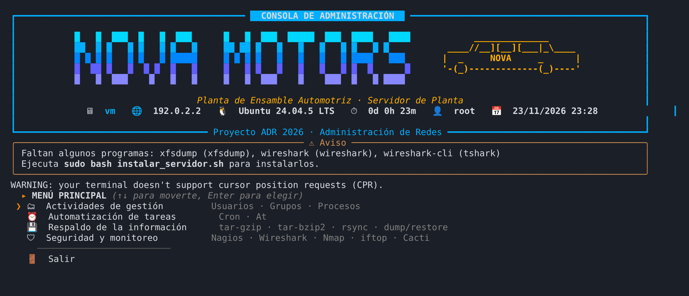

# NOVA MOTORS · Consola de Administración (Proyecto ADR 2026)

Script en Python con un menú de terminal para administrar el servidor de una
**armadora automotriz** (empresa ficticia *Nova Motors*) sobre **AlmaLinux 9**.

## Archivos

| Archivo | Para qué sirve |
|---|---|
| `nova_admin.py` | El menú. Todo el proyecto en un solo script. |
| `instalar_servidor.sh` | Instala los paquetes y deja funcionando Nagios y Cacti. |



## Descargar en la VM

```bash
sudo dnf install -y git
git clone https://github.com/nova-cz/ProyectoRedes.git
cd ProyectoRedes
```

## Instalación (una sola vez, en la VM de AlmaLinux)

```bash
sudo bash instalar_servidor.sh          # todo (base + Nagios + Cacti)
sudo bash instalar_servidor.sh base     # o solo una parte: base | nagios | cacti
```

## Ejecutar

```bash
sudo python3 nova_admin.py
```

Se navega con las flechas ↑↓ y Enter. Ctrl+C cancela la operación actual.

## Estructura del menú

```
1. Actividades de gestión
   ├─ Usuarios ─ Alta · Baja · Modificar · Consulta
   ├─ Grupos   ─ Alta · Baja · Modificar · Consulta   (cada departamento = un grupo)
   ├─ Procesos ─ Por usuario activo · Del sistema      (+ top, pstree, kill)
   └─ Inicializar estructura de la planta (crea departamentos y /srv/planta con datos)
2. Automatización de tareas
   ├─ Cron ─ Listar (y eliminar) · Programar · Instalar 2 tareas de ejemplo
   └─ At   ─ Listar (y cancelar) · Programar
3. Respaldo de la información
   ├─ tar + gzip   ─ crear / restaurar / ver contenido
   ├─ tar + bzip2  ─ crear / restaurar / ver contenido
   ├─ rsync        ─ local o remoto por SSH, modo espejo, simulación
   └─ dump/restore ─ detecta la USB, la monta y respalda / y /boot (sistema completo)
4. Seguridad y monitoreo
   ├─ Panel en vivo (CPU, RAM, disco, red, procesos)
   ├─ Nmap · iftop · Wireshark
   ├─ Nagios (navegador)  ·  Cacti (navegador)
   └─ Estado de servicios
```

## Notas importantes

- **Tareas de ejemplo (cron):** reporte de estado cada 30 min y respaldo de producción
  de lunes a sábado a las 23:30. La tarea que ponga la profesora se escribe con
  "⌨ Escribir mi propio comando".
- **dump/restore:** AlmaLinux usa **XFS**, así que el script usa `xfsdump`/`xfsrestore`
  (es el dump/restore de XFS). Si la partición es ext4, usa `dump`/`restore`.
  Si la USB está en FAT32 el script ofrece formatearla en ext4 (límite de 4 GB por archivo).
  En VirtualBox: *Dispositivos › USB* para pasar la memoria a la VM.
- **Wireshark** necesita escritorio gráfico; sin escritorio se usa `tshark` en la terminal.
- **Nagios:** `http://localhost/nagios` · usuario `nagiosadmin` (contraseña definida al instalar,
  por defecto `nova2026`).
- **Cacti:** `http://localhost/cacti` · primer acceso `admin` / `admin` y seguir el asistente.
- Si Nagios o Cacti muestran error de permisos, puede ser SELinux: prueba `sudo setenforce 0`
  y vuelve a cargar la página.
- Todas las acciones quedan registradas en `/var/log/nova_admin.log`.
- Para cambiar el nombre de la empresa o los departamentos, edita las constantes al inicio de
  `nova_admin.py` (`EMPRESA`, `DEPARTAMENTOS`).
